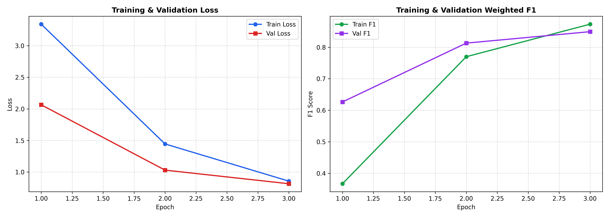
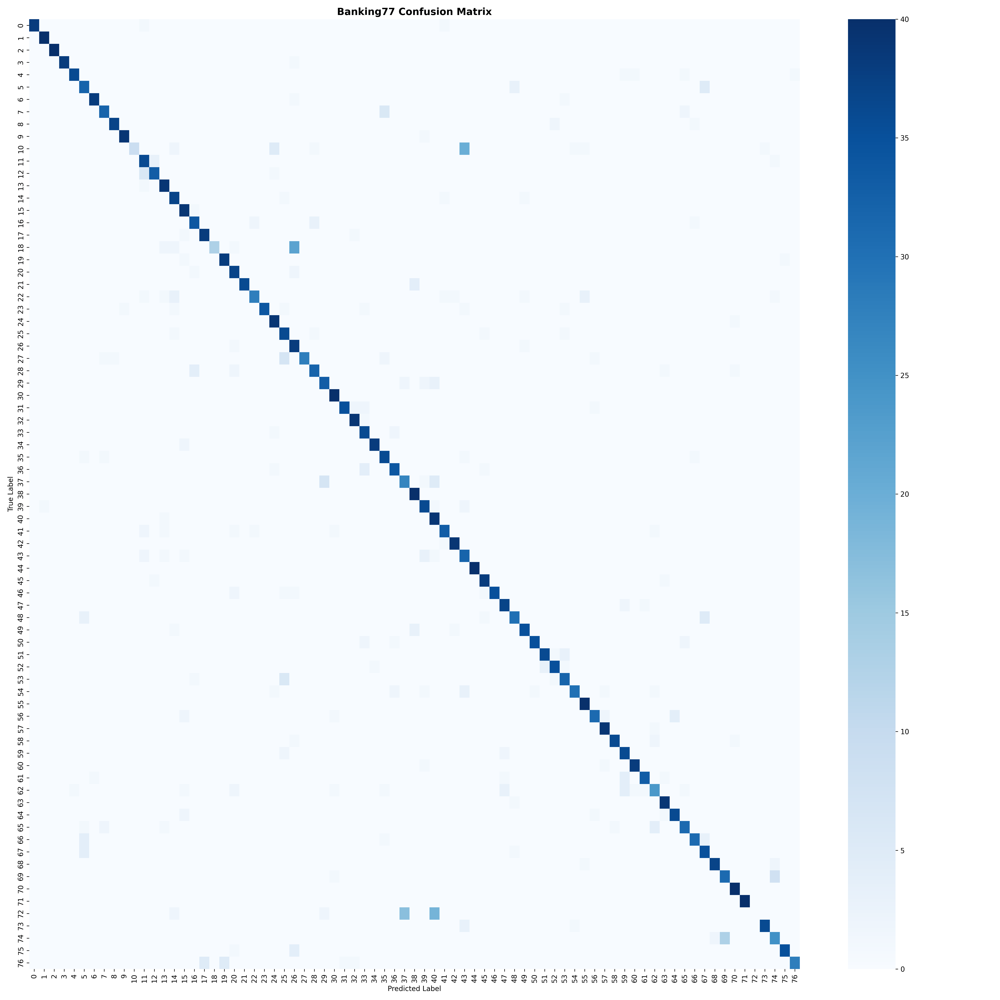

# BankIntent AI

> **DistilBERT-powered banking intent classification across 77 customer-support intents.**

[](https://www.python.org/downloads/)
[](https://pytorch.org/)
[](https://huggingface.co/transformers/)
[](https://huggingface.co/Parthiv-Jethva/bankintent-ai)
[](LICENSE)

A production-quality customer-support intent classification system built with **PyTorch**, **Hugging Face Transformers**, and **DistilBERT** on the **PolyAI/banking77** dataset.

The system classifies natural-language banking customer queries across **77 fine-grained intent classes** with high confidence, optimized for automated ticket routing, conversational AI assistants, and customer service escalation workflows.

---

## Architecture Overview


```text
Customer Query
      ↓
Tokenizer (WordPiece, max_len=128)
      ↓
Token IDs + Attention Mask Tensors
      ↓
DistilBERT Transformer Encoder (6 layers, 768 hidden dimension)
      ↓
Linear Classification Head (Dropout + Dense 768 → 77)
      ↓
77 Intent Class Logits
      ↓
Softmax Probabilities
      ↓
Predicted Intent & Confidence Score
```

---

## Features

- **DistilBERT Base Architecture:** Lightweight, low-latency transformer model (66M parameters) maintaining ~97% of BERT's performance with 60% faster inference.
- **Stratified Data Pipeline:** Splits original training data into stratified train (85%) and validation (15%) subsets. Keeps the official 3,080 test samples untouched until final evaluation.
- **Validation-Driven Checkpoint Selection:** Model checkpoints are evaluated after each epoch and saved based on **Validation Weighted F1** score to prevent test-set leakage.
- **Comprehensive Evaluation:** Generates full classification reports, precision, recall, macro/weighted F1, and high-resolution 77-class confusion matrices.
- **Detailed Error Analysis:** Diagnostic breakdown of semantic overlap in customer banking inquiries.
- **Interactive Gradio Web UI:** Full-featured dashboard with dynamic Top-K candidate inspection, real-time latency monitoring, and automated department triage routing.
- **Hugging Face Spaces Bundle:** Pre-packaged deployment folder (`space/`) ready for instant one-click deployment.
- **Published Hub Model:** Fine-tuned weights publicly available on Hugging Face at [`Parthiv-Jethva/bankintent-ai`](https://huggingface.co/Parthiv-Jethva/bankintent-ai).

---

## Dataset

This project utilizes the **[PolyAI/banking77](https://huggingface.co/datasets/PolyAI/banking77)** benchmark dataset:
- **Total Queries:** 13,082 real customer queries across retail banking.
- **Number of Classes:** 77 fine-grained intents (e.g., `card_delivery_estimate`, `declined_card_payment`, `exchange_rate`, `compromised_card`).
- **Official Test Set:** 3,080 queries (strictly balanced with exactly 40 queries per class).

### Train / Validation Split Policy
Rather than tuning on the official test set (a common data leakage mistake), the dataset is partitioned as follows:
```text
Original train (10,002 samples)
     ├── Stratified Train (8,501 samples)
     └── Stratified Validation (1,501 samples) -> Used for checkpoint selection

Original test (3,080 samples)
     └── Final Test Set -> Used exclusively for final evaluation
```

---

## Training Configuration & Hyperparameters

The model training and fine-tuning parameters:

| Parameter | Value | Rationale |
|---|---|---|
| **Base Model** | `distilbert-base-uncased` | Fast inference, lightweight footprint |
| **Max Sequence Length** | 128 | Covers >99.8% of banking queries without truncation |
| **Batch Size** | 16 | Stable stochastic gradient descent on GPU/CPU |
| **Learning Rate** | `2e-5` | Recommended fine-tuning rate for BERT architectures |
| **Optimizer** | `AdamW` ($\beta_1=0.9, \beta_2=0.999$) | Decoupled weight decay for transformers |
| **Weight Decay** | `0.01` | L2 regularization against overfitting |
| **Warmup Ratio** | `0.10` (10% of total steps) | Linear warmup prevents early divergence |
| **Scheduler** | Linear decay with warmup | Smooth learning rate annealing |
| **Gradient Clipping** | `1.0` max norm | Stabilizes backpropagation |
| **Epochs** | 3 | Full convergence without overfitting |

---

## Performance & Evaluation Results

Evaluated strictly on the held-out official Banking77 test set (3,076 samples across 77 classes):

| Metric | Score |
|---|---|
| **Accuracy** | **85.66%** |
| **Weighted F1** | **84.94%** |
| **Total Test Samples** | 3,076 |
| **Classes Evaluated** | 77 Banking Intents |

### Training History & Curves


### Confusion Matrix (77 Classes)


Detailed per-class precision, recall, and F1 scores are available in [`outputs/classification_report.txt`](outputs/classification_report.txt).

---

## Error Analysis & Insights

In-depth error analysis on misclassified queries reveals three primary patterns of ambiguity:

1. **Near-Synonymous Intent Boundaries:**
   - *Example:* "When will my replacement card arrive?" classified as `card_arrival` instead of `card_delivery_estimate`.
   - *Insight:* Both intents share almost identical semantics; user wording rarely distinguishes tracking arrival from estimating delivery dates.
2. **Cost vs. Pricing Inquiries:**
   - *Example:* "What does it cost to exchange USD to EUR?" classified as `exchange_rate` instead of `exchange_charge`.
   - *Insight:* The word "cost" can refer either to currency exchange fees (the charge) or the FX rate spread.
3. **Hierarchical Overlap:**
   - *Example:* "Can I create a disposable card for online shopping?" classified as `getting_virtual_card` instead of `get_disposable_virtual_card`.
   - *Insight:* Disposable cards are a strict subset of virtual cards in the banking platform.

---

## Project Structure

```text
BankIntent_AI/
├── README.md                           # Comprehensive documentation & results
├── requirements.txt                    # Pinned, tested dependencies (including Gradio)
├── app.py                              # Interactive Gradio web application
├── .gitignore                          # Excludes secrets, virtual environments, and caches
├── .env.example                        # Template for environment configuration
├── LICENSE                             # MIT License
│
├── notebooks/                          # Interactive experimentation & training
│   └── banking77_experiments.ipynb     # Complete training, evaluation & diagnostics walkthrough
│
├── space/                              # Hugging Face Spaces deployment bundle
│   ├── app.py                          # Self-contained Gradio interface
│   ├── requirements.txt                # Spaces runtime dependencies
│   └── README.md                       # Spaces YAML configuration & metadata
│
├── outputs/                            # Serialized evaluation artifacts
│   ├── metrics.json                    # Benchmark accuracy and F1 scores
│   ├── classification_report.txt       # Per-intent precision, recall, and F1
│   ├── training_curves.png             # Epoch loss and F1 plots
│   └── confusion_matrix.png            # High-resolution 77x77 confusion heatmap
│
├── models/
│   └── README.md                       # Instructions on downloading weights from HF Hub
│
└── docs/
    └── architecture.png                # High-resolution pipeline architecture diagram
```

---

## Installation & Setup

We recommend using [`uv`](https://github.com/astral-sh/uv) or standard `pip` for package management:

### 1. Clone the Repository
```bash
git clone https://github.com/Jethva-Parthiv/BankIntent-AI.git
cd BankIntent-AI
```

### 2. Create Virtual Environment & Install Dependencies
```bash
# Create virtual environment
uv venv .venv

# Activate virtual environment
# Windows (PowerShell):
.venv\Scripts\Activate.ps1
# Linux / macOS:
source .venv/bin/activate

# Install dependencies
uv pip install -r requirements.txt
```

### 3. Configure Environment Variables (Optional)
Copy `.env.example` to `.env`:
```bash
cp .env.example .env
```
```env
HF_TOKEN=your_hf_token_here
HF_REPO_ID=Parthiv-Jethva/bankintent-ai
WANDB_API_KEY=your_wandb_api_key_here
WANDB_PROJECT=bankintent-ai
```

---

## Training & Experimentation

The end-to-end training and evaluation pipeline is demonstrated step-by-step in [`notebooks/banking77_experiments.ipynb`](notebooks/banking77_experiments.ipynb):

1. **Exploratory Data Analysis (EDA):** Class distribution and query length analysis.
2. **Stratified Splitting:** 85% train / 15% validation split ensuring balanced representation across all 77 classes.
3. **Tokenization:** WordPiece subword encoding with DistilBERT tokenizer.
4. **Fine-Tuning:** Training DistilBERT with PyTorch, AdamW, and linear warmup scheduling.
5. **Evaluation:** Detailed test metrics, classification reports, and confusion matrix visualizations.

---

## Interactive Web Application (Gradio)

The interactive Gradio application loads the fine-tuned model from Hugging Face Hub (`Parthiv-Jethva/bankintent-ai`), performs real-time classification, returns Top-K confidence distributions with visual progress bars, and maps queries into automated banking department triage actions (Fraud Prevention, Card Logistics, Forex, Payments, KYC, etc.).

### Run Locally
```bash
python app.py
```
Open `http://127.0.0.1:7861` in your browser.

---

## Python Inference (Hugging Face Hub)

Anyone can run inference directly with the published model using Hugging Face Transformers:

```python
import torch
from transformers import AutoTokenizer, AutoModelForSequenceClassification

model_id = "Parthiv-Jethva/bankintent-ai"

tokenizer = AutoTokenizer.from_pretrained(model_id)
model = AutoModelForSequenceClassification.from_pretrained(model_id)

query = "Why was my card payment declined?"
inputs = tokenizer(query, return_tensors="pt", truncation=True, max_length=128)

with torch.no_grad():
    logits = model(**inputs).logits
    probabilities = torch.softmax(logits, dim=-1)
    predicted_class_id = torch.argmax(probabilities, dim=-1).item()

predicted_intent = model.config.id2label[predicted_class_id]
confidence = probabilities[0][predicted_class_id].item()

print(f"Predicted Intent: {predicted_intent}")
print(f"Confidence: {confidence * 100:.2f}%")
```

---

## Deploy to Hugging Face Spaces

You can deploy the Gradio app directly to **Hugging Face Spaces** for free public hosting:

### Option 1: Manual Web Upload (Simplest)
1. Go to [huggingface.co/new-space](https://huggingface.co/new-space).
2. Set **Space Name** to `bankintent-ai`.
3. Select **Gradio** as the Space SDK and set visibility to **Public**.
4. In the **Files** tab of your new Space, upload the 3 files from the [`space/`](space/) directory:
   - `app.py`
   - `requirements.txt`
   - `README.md` (contains the required YAML metadata header)
5. Hugging Face Spaces will automatically build the container and launch your live app!

### Option 2: Git Push to Space
```bash
# Clone your new Hugging Face Space repository
git clone https://huggingface.co/spaces/YOUR_USERNAME/bankintent-ai
cd bankintent-ai

# Copy files from the space/ bundle
cp -r /path/to/BankIntent-AI/space/* .

# Commit and push
git add .
git commit -m "Deploy BankIntent AI Gradio demo"
git push
```

---

## Limitations

- **Domain Specificity:** The classifier is fine-tuned strictly on retail banking queries. Performance will degrade on general IT support, e-commerce, or healthcare dialogues.
- **Short Texts:** Extremely short or ambiguous inputs (e.g., "help", "yes", "urgent") cannot provide sufficient semantic signal for 77-class discrimination.
- **Static Ontology:** New intents introduced by bank product changes require collecting supplementary samples and incremental fine-tuning.

---

## License

This project is licensed under the [MIT License](LICENSE).
